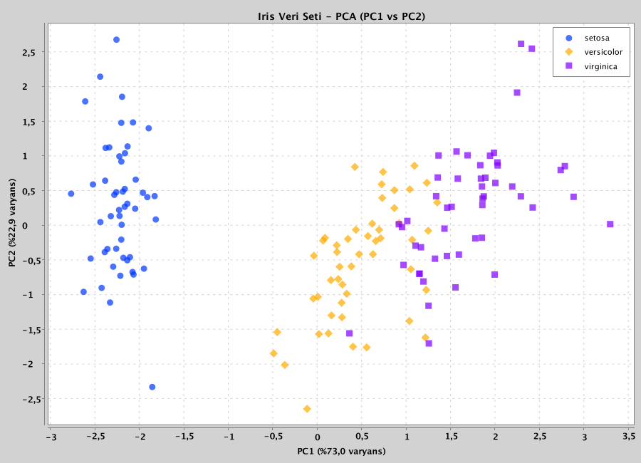
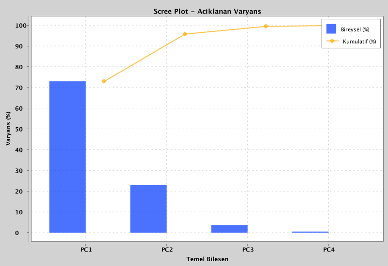

# iris-pca-aop
Iris veri seti üzerinde PCA uygulaması; AspectJ (AOP) ile süre ölçümü, loglama, veri doğrulama ve hata yönetimi (Java).
# Iris Veri Seti Üzerinde PCA ve AOP (Java / AspectJ)

Iris veri seti üzerinde **Temel Bileşenler Analizi (PCA)** uygulayan ve bu süreci **Aspect Oriented Programming (AOP)** ile izleyen, loglayan ve performans açısından ölçen bir Java projesidir.

PCA'nın kendisi iş sınıflarında yer alır. Süre ölçümü, loglama, veri doğrulama ve hata yönetimi ise iş kodundan ayrı, **aspect** adı verilen sınıflarda toplanmıştır.

> Ders ödevi olarak hazırlanmıştır. &nbsp;|&nbsp; Hazırlayan: -Ayşe Yılmaz-

---

## İçindekiler
- [Özellikler](#özellikler)
- [Kullanılan Teknolojiler](#kullanılan-teknolojiler)
- [Veri Seti](#veri-seti)
- [PCA Nasıl Çalışıyor?](#pca-nasıl-çalışıyor)
- [AOP Nasıl Kullanıldı?](#aop-nasıl-kullanıldı)
- [Proje Yapısı](#proje-yapısı)
- [Kurulum ve Çalıştırma](#kurulum-ve-çalıştırma)
- [Çıktılar](#çıktılar)
- [Sonuçlar](#sonuçlar)
- [Loglama ve Performans Raporu](#loglama-ve-performans-raporu)
- [Hata Yönetimi Gösterimi](#hata-yönetimi-gösterimi)

---

## Özellikler

- Iris veri setinin yüklenmesi, özetlenmesi ve standardizasyonu
- PCA'nın adım adım, kütüphane çağrısı olmadan uygulanması (merkezleme, kovaryans, özdeğer ayrıştırma, projeksiyon)
- Sonucun matematiksel doğrulanması (bileşenlerin diklik ve varyans kontrolü)
- Sonuçların grafiklerle görselleştirilmesi (PC1-PC2 dağılım grafiği ve scree plot)
- AOP ile:
  - metot çağrılarının **süre ölçümü** (duvar saati, CPU süresi, heap değişimi)
  - **veri doğrulama** (null, NaN/Infinity, düzensiz matris, geçersiz bileşen sayısı)
  - işlem adımlarının **loglanması**
  - merkezi **hata yönetimi**
  - **performans metriklerinin** toplanması ve raporlanması

## Kullanılan Teknolojiler

| Amaç | Teknoloji |
|---|---|
| Dil | Java 17 |
| Derleme | Maven |
| AOP | AspectJ 1.9.22 (compile-time weaving) |
| Özdeğer çözümü | Apache Commons Math 3.6.1 |
| Görselleştirme | XChart 3.8.8 |
| Loglama | SLF4J + Logback |

## Veri Seti

Iris, makine öğrenmesinde en sık kullanılan klasik veri setlerinden biridir (Ronald Fisher, 1936).

- **150 örnek**, **4 özellik**, **3 sınıf** (her sınıftan 50 örnek)
- Özellikler (cm): `sepal_length`, `sepal_width`, `petal_length`, `petal_width`
- Sınıflar: `setosa`, `versicolor`, `virginica`
- Eksik değer yoktur. Veri `src/main/resources/iris.csv` dosyasında tutulur.

## PCA Nasıl Çalışıyor?

PCA, çok boyutlu veriyi bilgi kaybını en aza indirerek daha az boyuta indirger. Burada 4 boyutlu veri 2 boyuta indirilir ve grafikte gösterilir.

`PCAAnalyzer` sınıfındaki adımlar:

1. **Standardizasyon** (`DataPreprocessor`): her özellik ortalama 0, standart sapma 1 olacak şekilde ölçeklenir.
2. **Merkezleme** (`centerData`): sütun ortalamaları çıkarılır.
3. **Kovaryans matrisi** (`computeCovariance`): `C = XᵀX / (n-1)`
4. **Özdeğer ayrıştırma** (`decompose`): özdeğer ve özvektörler bulunur, büyükten küçüğe sıralanır.
5. **Projeksiyon** (`project`): veri özvektörlere yansıtılarak yeni koordinatlar (skorlar) elde edilir.
6. **Doğrulama** (`verify`): bileşenlerin birbirine dik ve birim uzunlukta olduğu, her bileşenin skor varyansının özdeğerine eşit olduğu kontrol edilir (tolerans 1e-8).

## AOP Nasıl Kullanıldı?

`service` paketindeki iş sınıfları loglama, zamanlama veya hata yakalama kodu **içermez**. Bu işler aspect sınıflarına taşınmıştır ve `service` paketindeki tüm public metotlara otomatik uygulanır (`Pointcuts.serviceMethods()`).

| Aspect | Advice | Görevi |
|---|---|---|
| `ValidationAspect` | `@Before` | Metot çalışmadan önce argümanları doğrular |
| `LoggingAspect` | `@Before`, `@AfterReturning` | Metot girişini (argümanlar) ve çıkışını (sonuç özeti) loglar |
| `TimingAspect` | `@Around` | Süre, CPU süresi ve heap değişimini ölçer, `MetricsCollector`'a yazar |
| `ExceptionHandlingAspect` | `@Around` | Hataları yakalar, bir kez loglar, anlamlı hata olarak yeniden fırlatır |

Aspect sırası `@DeclarePrecedence` ile belirlenmiştir:

```
ExceptionHandling → Timing → Logging → Validation → [hedef metot]
```

Hata yönetimi en dışta olduğu için her şeyi sarar. Zamanlama, doğrulama hatalarını da "hatalı çağrı" olarak sayar. Aspect'ler **derleme zamanında** koda işlendiği için sınıf içi (`this.`) çağrılar da yakalanır.

## Proje Yapısı

```
iris-pca-aop
├── pom.xml
├── README.md
└── src/main
    ├── java/com/example/pca
    │   ├── Main.java
    │   ├── service/
    │   │   ├── IrisDataLoader.java       # CSV okuma
    │   │   ├── DatasetInspector.java     # veri seti özeti
    │   │   ├── DataPreprocessor.java     # standardizasyon
    │   │   ├── PCAAnalyzer.java          # PCA
    │   │   └── Visualizer.java           # grafikler
    │   ├── aspect/
    │   │   ├── Pointcuts.java            # ortak pointcut + aspect sırası
    │   │   ├── TimingAspect.java
    │   │   ├── LoggingAspect.java
    │   │   ├── ValidationAspect.java
    │   │   ├── ExceptionHandlingAspect.java
    │   │   └── MetricsCollector.java     # metrik deposu ve rapor
    │   ├── model/                        # IrisDataset, PCAResult, EigenResult
    │   ├── exception/                    # özel hata sınıfları
    │   └── util/                         # Matrices, Describe
    └── resources
        ├── iris.csv
        └── logback.xml
```

## Kurulum ve Çalıştırma

**Gereksinimler:** JDK 17 veya üstü, Maven 3.8+ (IntelliJ içindeki Maven de kullanılabilir)

```bash
git clone https://github.com/KULLANICI_ADI/iris-pca-aop.git
cd iris-pca-aop

# Normal çalıştırma
mvn clean compile exec:java

# Hata yönetimi gösterimi ile birlikte
mvn compile exec:java -Dexec.args="--demo-errors"
```

> AOP derleme sırasında Maven eklentisiyle uygulandığı için program IDE'nin normal "Run" düğmesiyle değil, yukarıdaki Maven komutlarıyla çalıştırılmalıdır.

Windows'ta Türkçe karakterler bozuk görünürse:
```
set MAVEN_OPTS=-Dfile.encoding=UTF-8 -Dstdout.encoding=UTF-8
```

## Çıktılar

Program çalışınca şu dosyalar oluşur:

| Dosya | İçerik |
|---|---|
| `output/pca_scatter.png` | PC1-PC2 dağılım grafiği (türlere göre renkli) |
| `output/pca_scree.png` | Bileşen başına ve kümülatif açıklanan varyans |
| `logs/pca-app.log` | Genel uygulama logu |
| `logs/performance.log` | Her metot çağrısının performans kaydı |
| `logs/errors.log` | Yalnızca uyarı ve hatalar |
| `logs/performance-report.csv` | Metot bazlı performans özeti |

Log dosyaları günlük ve boyuta göre otomatik arşivlenir (`logback.xml`).

## Sonuçlar

Standardize edilmiş veri üzerinde PCA sonuçları:

| Bileşen | Özdeğer | Açıklanan Varyans | Kümülatif |
|---|---|---|---|
| PC1 | 2.9185 | %72.96 | %72.96 |
| PC2 | 0.9140 | %22.85 | %95.81 |
| PC3 | 0.1468 | %3.67 | %99.48 |
| PC4 | 0.0207 | %0.52 | %100.00 |

İlk iki bileşen toplam varyansın yaklaşık **%96'sını** korur. Bu yüzden 4 boyutlu veri 2 boyuta indirildiğinde de türler grafikte rahatça ayırt edilir: `setosa` diğerlerinden net biçimde ayrılırken `versicolor` ve `virginica` kısmen iç içe geçer.

Bu değerler bağımsız bir hesapla (NumPy, `np.cov` + `eigh`) karşılaştırılmış ve scikit-learn'ün bilinen Iris PCA sonuçlarıyla örtüşmektedir.

Program çalıştırıldıktan sonra grafikleri buraya ekleyebilirsiniz:

```markdown


```

## Loglama ve Performans Raporu

Konsolda her metot için giriş ve çıkış satırları görülür:

```
>> PCAAnalyzer.centerData(double[150x4])
<< PCAAnalyzer.centerData tamamlandi -> double[150x4]
```

Program sonunda `MetricsCollector` her metot için şunları içeren bir tablo basar:

- çağrı sayısı ve hatalı çağrı sayısı
- toplam, ortalama, minimum ve maksimum süre (ms)
- toplam CPU süresi
- heap bellek değişimi (KB)
- başarılı ve başarısız doğrulama sayıları

Süreler **kapsayıcıdır**: `PCAAnalyzer.compute` süresi, içinde çağırdığı `centerData`, `computeCovariance`, `decompose` ve `project` sürelerini de içerir. Heap değişimi çöp toplayıcı nedeniyle yaklaşık bir değerdir ve negatif çıkabilir. 100 ms üzerindeki çağrılar için uyarı loglanır.

## Hata Yönetimi Gösterimi

`--demo-errors` parametresiyle program bilerek hatalı girdilerle çağrılır. Program çökmez, her hata ilgili aspect tarafından yakalanıp anlaşılır bir mesajla bildirilir:

| Senaryo | Yakalanan hata |
|---|---|
| Olmayan dosya | `DataLoadException` |
| NaN içeren veri | `DataValidationException` |
| Düzensiz (jagged) matris | `DataValidationException` |
| `null` veri | `DataValidationException` |
| Sabit sütun (std = 0) | `DataValidationException` |
| Geçersiz bileşen sayısı (k = 9) | `DataValidationException` |

Beklenmeyen bir hata olursa `ExceptionHandlingAspect` bunu stack trace ile loglar ve `PcaProcessingException` içine sararak yeniden fırlatır.
